# Anchor Buddy architecture

Internal local-storage, downloaded-asset and native watch identifiers retain their original names for compatibility. These identifiers contain no user data; retaining them prevents a product rename from discarding existing local state.

The mobile app and API execute the same deterministic assessment package. AI is optional and currently unavailable. Regional data crosses an explicit review/publication boundary before it can support live search; native monitoring remains independent of the planner, JavaScript, network and AI.

```mermaid
flowchart LR
  Sources[Official chart, weather, tide and spatial sources] --> Ingest[Python and GDAL ingestion]
  Curated[Reviewed rules, tariffs, holding and station relationships] --> Ingest
  Ingest --> Raw[Unsimplified analysis SQLite]
  Ingest --> Display[Separate display assets]
  Ingest --> Index[(Optional PostGIS index)]
  Raw --> Review[Assembled assessment and review gates]
  Display --> Review
  Review --> Packs[Immutable versioned pack and SHA-256 manifest]
  Packs --> API[Node and Fastify API]
  Packs --> Store[Operator object storage]
  API --> Stage[Mobile staged verification and activation]
  Store -. HTTPS pack delivery .-> Stage
  Stage --> Local[(Local profile and regional evidence)]
  Local --> Domain[Shared TypeScript assessment engine]
  API --> Domain
  Domain --> UI[React Native map, list and anchor plan]
  UI --> Confirm[User confirms actual anchor, radius and test alarm]
  Confirm --> Native[Swift or Kotlin native watch]
  Native --> Alerts[Local notifications and persisted state]
  Assistant[Disabled ChatGPT partner integration] -. future explanations only .-> Domain
```

## Packages and responsibilities

| Component              | Responsibility                                                                                                                                                                   |
| ---------------------- | -------------------------------------------------------------------------------------------------------------------------------------------------------------------------------- |
| `apps/mobile`          | Expo development app, map/list discovery, vessel and search inputs, result detail, anchor planning, offline installation and native watch controls                               |
| `packages/domain`      | Serializable interfaces; strict input validation; deterministic geometry, depth/rode/footprint checks, temporal and spatial evidence checks, tariffs and ranking                 |
| `modules/anchor-watch` | Expo bridge and config plugin; native location processing, permissions, notifications, persistence and liveness verification; replay harnesses exist only in automated tests     |
| `apps/api`             | Fastify endpoints, public provider metadata, NWS/CO-OPS adapter boundaries, read-only immutable-pack delivery and shared-engine searches                                         |
| `workers/ingest`       | Selected NOAA ENC retrieval, GDAL S-57 extraction/update handling, provenance, spatial imports, pack construction, checksums, optional PostGIS indexing and operator publication |
| `infra`                | Container recipes, local Compose orchestration and the PostGIS provenance/geometry/pack schema                                                                                   |

PostGIS is an operator index, not a hidden dependency of offline assessment. The API can serve live discovery and persistent source snapshots without a database; synthetic packs are rejected. The Compose API consumes a read-only pack volume. Object-storage publication is an explicit operator command, not an automatic side effect of app search.

## Application flow and local state

The primary tabs are Explore, Saved and Settings. Initial setup records vessel configuration, search defaults and display units before a guided tour. Explore has no active results until the user submits a search; the search's stay window is entered in the device's local timezone and converted to timestamp instants for assessment.

Quick place filters, advanced filters/sorting and map/list view controls operate on the same assessment set. Depth and seabed layers are enabled by default; marks are independently selectable. Map display switches do not change the analysis engine's hazard, depth or restriction inputs. Seabed preference is an explicit search input, not inferred from the layer's visibility.

An anchor plan is reached from result details and retains its adjusted position and rode while moving to the watch and back. The watch is a persistent header control, separate from the three primary tabs. Navigation, saved searches and closing a search never arm, stop or recenter native monitoring. Required initial setup is deferred when an existing watch needs attention.

Saved searches contain their preferences, filters, evidence version, vessel name and dated result summaries. Reopening a saved search recalculates using current vessel and regional evidence; it does not restore an old result as a fresh recommendation. Settings contains vessel/search defaults, units, language, layer defaults, offline data and provider configuration. English is the only implemented interface language.

## Evidence and assessment contract

All engine distances and depths use metres; winds/currents use knots; directions use true degrees; positions use `[longitude, latitude]`; timestamps represent instants. Display conversion is separate. Source currency is retained; unlike currencies are grouped rather than silently converted.

A `RegionPack` contains source records, unsimplified depth/hazard/restriction/holding geometry, positive coverage declarations, forecast and water-level intervals, places, tariffs, display metadata and review state. Weather and tide intervals identify their applicable coverage areas; a generic regional coverage polygon does not make an unrelated grid cell or tide station valid everywhere. A reviewed tide-station relationship must apply to the evaluated location, footprint, datum and interval. Unknown values remain unknown.

The engine evaluates arrival through departure contingency and reports one of three outcomes: `passes`, `excluded`, or `insufficient_evidence`. An exclusion or missing critical evidence cannot be compensated by a better price or distance. Synthetic factories are isolated in a test-only entry point. Runtime installation, restoration, live responses and API searches reject synthetic or unclassified source provenance.

Assessment time is an explicit input. Mobile supplies a current timestamp and refreshes it every minute, on foreground return and on browser reconnect; the API supplies its own server timestamp. Expired evidence or an elapsed stay cannot retain a current pass. Open details are recalculated too. Omitted or historical context remains reproducible historical replay and is labelled accordingly. Reconnection triggers local reassessment; downloading newer evidence remains an explicit action in Settings.

For an anchor position, the engine expands its full-circle footprint using conservative upper depth bounds, bow height, equipment-specific reviewed scope and planned/deployed rode; it checks lower depth bounds for under-keel clearance. Depth changes inside an expanding footprint are reconsidered. Complete footprints are checked against unsimplified hazards, shallows, restrictions, habitat and coverage boundaries. Wind direction can explain exposure, but cannot shrink the full safety circle. Unresolved chart seams, unknown vertical datums, missing local conditions and unreviewed holding evidence cannot establish a pass.

Dock/mooring checks include published vessel and operational limits, berth/entrance depths, permission, access windows and known availability. These checks do not generate or verify an approach route. Straight-line proximity, an itemized cost estimate and site suitability remain separate from navigable access and an available berth.

Preferred-depth fallback tries +20%, then +30%, only if no initial candidate passes. It reruns the same constraints and labels the alternative. It never extends available rode, removes hazards or relaxes clearance. Candidate generation is deterministic and bounded; results disclose truncation, and generated suggestions are clustered only after assessment.

## Data preparation, packs and offline behavior

NOAA ENC extraction retains geometry, depth bounds, source edition/update sequence, datum metadata and provenance. Isolated soundings remain points. Display output is generated separately; rendering simplification is never used as analysis evidence. Official rule/notice imports preserve jurisdiction and validity dates while leaving legal applicability unresolved until reviewed. NWS grids retain missing marine fields; CO-OPS astronomical predictions are not treated as total water-level forecasts.

A complete domain assessment snapshot is an operator-assembled attachment. Real data requires maritime, coverage, geometry, station-mapping and on-water review gates with reviewer/date metadata. These are recorded assertions of external work; setting a boolean does not perform a review. API and mobile release gates must remain consistent.

Publication builds in staging, verifies assets, publishes an immutable version and updates the current pointer last. Mobile installation checks identity, schema, size and SHA-256 for every asset, stages them, and replaces its active record only after successful completion. Failed or interrupted replacement retains the previous active snapshot. Expiry is reevaluated when searching saved evidence; reconnecting and installing newer evidence does not reinterpret an old forecast as fresh.

Native mobile storage uses SQLite for profiles/preferences and installed assessment records, plus app-private regional files for verified assets. Ingestion creates a separate analysis SQLite artifact containing full geometry and indexing. The browser preview uses its web persistence adapters and Cache Storage, and cannot provide native background monitoring or native offline tile caching.

Offline chart caching is distinct from analysis caching. A reviewed manifest must authorize an operator-owned/licensed style and resources. MapLibre Native can then cache the permitted region. Public OpenStreetMap tiles are not bulk-downloaded; saving a source snapshot does not create a complete offline nautical chart.

## Native watch and service boundary

The watch receives an explicitly confirmed physical anchor position and alarm radius. It is not armed by AI or by merely selecting a suggested map pin. The bridge and native code require a recent test alarm, user confirmations and appropriate permissions. A new session starts in `arming` and becomes `monitoring` only after a fresh accurate fix. Poor accuracy, boundary overlap, stale location and an actual breach produce distinct states and latched alerts; acknowledging an alert cannot make a continuing problem disappear. Radius edits are explicit and never recenter the anchor.

The browser reports native monitoring as unavailable and exposes no simulator, artificial positions or alarm-test controls. Manual native watch inputs start blank unless supplied by an actual anchor plan; existing native sessions are queried without stopping, replacing or recentering them.

Swift uses CoreLocation background location and local notifications. Kotlin uses a user-started location foreground service with a persistent status notification and a separate alarm channel. Each native runtime evaluates fixes and monotonic freshness independently of JavaScript. Native state survives for inspection, but persisted “armed” state never proves a service is alive: after process death/restart the session is interrupted and must be explicitly rearmed. The UI verifies current status on resume and labels an unverified heartbeat accordingly.

The OS can stop or suspend execution, and sound settings can suppress notifications. No code can deliver a termination alert while its device/process is stopped. These are supplemental monitoring implementations; physical-device and on-water validation remain mandatory. See the [native module protocol](../modules/anchor-watch/README.md).

The assistant endpoint is deliberately disabled. There are no ChatGPT credentials, authorization tokens, password collection, API-key billing fallback or enabled AI watch controls. Future approved subscription access may explain immutable assessment outputs and call deterministic planning tools. It cannot manufacture evidence, change exclusions or operate a watch.

## Deployment boundary

The local Compose stack demonstrates container composition. It is not a production deployment: TLS ingress, rate limiting, operator authentication/publication controls, dependency remediation, backups, observability, source-refresh operations, privacy disclosures and device release/signing processes remain operator work. API provider adapters enforce host restrictions, timeouts and freshness; those controls do not replace deployment-level security or a complete regional data pipeline.

See the [release checklist](release-checklist.md) for the evidence required before distribution.
